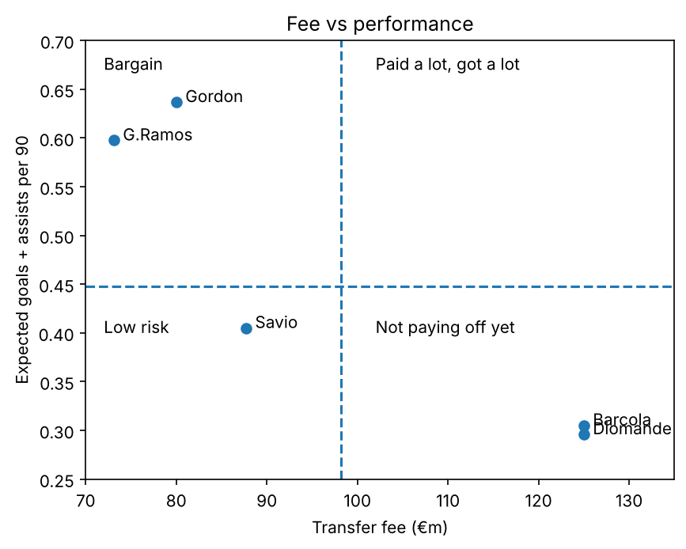
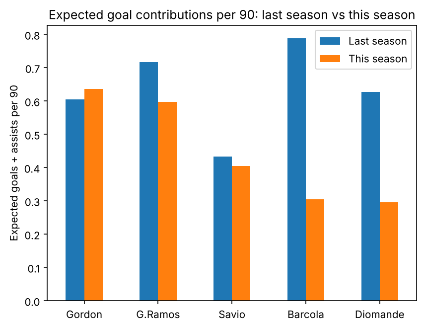

# Summer 2026's biggest attacking signings: worth the money?

**[▶ Live app](https://transfer-impact-gwes5jayjafr3tdspsddvw.streamlit.app/)** · Data as of 23 Oct 2026 (players) and 26–27 Oct 2026 (teams) · Version: v1 · Updated monthly

Clubs spent big on attackers this summer. This project asks a simple question: **are those signings paying off yet?** It looks at each player three ways:

1. **Output:** how much he's producing
2. **Value:** what each unit of that output has cost the club
3. **Team impact:** whether his team has improved since he arrived



## Key findings (so far)

- **Gordon (Barcelona) is the standout.** The best output of the five (0.64 expected goals + assists per 90) and the only player to improve on last season. Barcelona's goal difference per match is up from +1.6 to +2.9.
- **G.Ramos (AC Milan) is the best value.** Milan are paying the least per unit of output, and his brief was to fix their goals problem: Milan's goals per match are up 43%. He is down 17% on his own level from last season, though.
- **Savio (Spurs) is steady.** Almost exactly his level from last season, creating more chances than before, but teammates haven't finished them. Currently injured.
- **Barcola (Liverpool) has the biggest drop.** Best of the five last season, now near the bottom (down 61%). Liverpool's big chances per match have halved since Salah left.
- **Diomande (Real Madrid) is the most complicated story.** Lowest value on expected stats, but the best goal involvement per minute played, and Madrid's attack has improved. He's 19, so his fee also pays for potential this metric can't see.

> **It's early.** Most players have played around 300–600 minutes. These verdicts are a snapshot and will change with each monthly update.

## The verdicts

| Rank | Player | Club | Fee (€m) | Expected G+A per 90 | €m per unit of output | Change vs last season | Verdict |
|---|---|---|---|---|---|---|---|
| 1 | Gordon | Barcelona | 80.0 | 0.64 | 125.6 | +5.2% | 🟢 Natural fit |
| 2 | G.Ramos | AC Milan | 73.1 | 0.60 | 122.3 | −16.7% | 🟢 Natural fit |
| 3 | Savio | Spurs | 87.7 | 0.41 | 216.5 | −6.4% | 🟡 Steady |
| 4 | Barcola | Liverpool | 125.0 | 0.31 | 409.6 | −61.3% | 🔴 Still adjusting |
| 5 | Diomande | Real Madrid | 125.0 | 0.30 | 422.2 | −52.8% | 🔴 Still adjusting |

- 🟢 **Natural fit:** above the group's average output
- 🟡 **Steady:** below average, but within 10% of last season's level
- 🔴 **Still adjusting:** below average and down more than 10% on last season

The labels are deliberately factual rather than harsh: they describe how the move is going so far, and they're expected to change as the season goes on.

## This season vs last season



### Team impact (per match, last season → this season)

| Club | Goals | xG | xG against (lower = better) | Goal difference |
|---|---|---|---|---|
| Barcelona | 2.5 → 4.0 | 2.28 → 3.48 | 1.19 → 1.10 | +1.6 → +2.9 |
| AC Milan | 1.4 → 2.0 | 1.59 → 1.91 | 1.17 → 1.18 | +0.5 → +1.1 |
| Real Madrid | 2.0 → 2.5 | 2.05 → 2.42 | 1.08 → 1.03 | +1.1 → +1.5 |
| Liverpool | 1.7 → 1.4 | 1.61 → 1.51 | 1.25 → 1.20 | +0.3 → +0.4 |
| Spurs | 1.3 → 1.0 | 1.05 → 1.02 | 1.38 → 1.24 | −0.2 → −0.3 |

A team improving doesn't prove the signing caused it. Most of these clubs made several signings, and some changed manager. So each player is also judged on his share of his team's goals and minutes (see the player profiles in the app).

## Method

**Which players:** the five highest-fee permanent signings of forwards (centre-forwards and wingers) into Europe's top five leagues in summer 2026. Loans were excluded. Several of the window's other big attacking fees went to the Saudi Pro League, which this project excludes.

**Fees:** as listed by Transfermarkt, in euros, without add-ons.

**Performance data:** FotMob (Opta), league games only. One source is used for everything, because each provider's xG model is different.

### Key measures

- **Expected goals + assists per 90:** the quality of chances a player gets and creates, scaled to a full match so players with different minutes can be compared fairly.
- **€m per unit of output:** fee ÷ expected goals + assists per 90. Lower is better value.
- **Change vs last season:** this season's output compared with the player's full league season at his old club.
- **Team stats:** per match. xG against = xG − xG difference.

### Choices and robustness checks

- Penalties are included in xG ("any goal is a goal"). Using non-penalty xG instead, Gordon would rank as the best value rather than G.Ramos.
- Value for money is not the same as quality. A high fee can also reflect a player's age, potential and resale value.
- FotMob's "defensive contributions" stat is counted differently in different leagues, so defensive comparisons are built from the individual parts (tackles, interceptions, blocks, clearances).

### Limitations

- **Small samples:** most players have 300–600 minutes this season.
- Several players changed league, so some drop-off may reflect a tougher league or new role, not a worse player.
- Averages come from only five players, so "above average" means "above this group".

## What's in this repo

| File | What it is |
|---|---|
| `app.py` | The Streamlit app |
| `profiles.py` | Written profile for each player |
| `Transfer_impact.ipynb` | Notebook with the analysis and charts |
| `transfers.csv` | Player data: fees, this season and last season |
| `teams.csv` | Team data: this season and last season |
| `requirements.txt` | Python libraries the app needs |

Built with **Python, pandas, matplotlib and Streamlit**.

### Run it locally

```bash
pip install -r requirements.txt
streamlit run app.py
```

## What's next

- Monthly updates to the data and verdicts, tracking who climbs the table towards "Signing of the Season"
- More players, and filters to sort by performance, value or fee
- Statistics to separate real improvement from luck
- A model estimating a "fair fee" for each player
- Midfielders and defenders

## Changelog

- **v1 (Nov 2026):** first release. 5 players, data as of 23–27 Oct 2026.

---

Built by **Praveen Kesavan Gopinath** · [LinkedIn](https://www.linkedin.com/in/praveen-kesavan-gopinath-81a1b52b9/)
